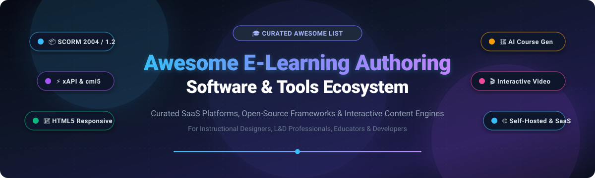

# 🎓 Awesome E-Learning Authoring Software

  
  
  
  
  

**A curated index of leading SaaS platforms, open-source course authoring tools, and interactive content engines.**  
*Empowering instructional designers, L&D managers, curriculum developers, educators, and course engineers to build, package, and deliver accessible SCORM 1.2, SCORM 2004, xAPI (Tin Can), cmi5, and responsive HTML5 learning experiences.*

---

## 📑 Table of Contents

- [📊 Sector Overview & Market Dynamics](#-sector-overview--market-dynamics)
- [💼 SaaS & Commercial Hosted Platforms](#-saas--commercial-hosted-platforms)
- [🔓 Open-Source GitHub Projects](#-open-source-github-projects)
- [🧰 Complementary Asset & Authoring Utilities](#-complementary-asset--authoring-utilities)
- [🤝 How to Contribute](#-how-to-contribute)
- [💖 Support & Sponsoring](#-support--sponsoring)
- [⭐ Star History](#-star-history)
- [📜 Disclaimer](#-disclaimer)

---

## 📊 Sector Overview & Market Dynamics

The global **E-Learning Authoring Tools** software market was valued between **$1.3 billion and $1.6 billion** for dedicated authoring software (and exceeding **$6.2 billion** across the broader content-creation software ecosystem), with projected compound annual growth rates (**CAGR**) between **11% and 14%** toward 2030+.

From a structural perspective, the market is **moderately fragmented**: while enterprise incumbents such as **Adobe** and **Articulate** capture substantial enterprise mindshare and multi-seat corporate contracts, there is no single winner-take-all monopoly. The proliferation of low-barrier cloud SaaS infrastructure, rapid enterprise adoption of AI-assisted subject-matter-expert (SME) authoring, microlearning modalities, and extensible open-source frameworks (such as Adapt, Open edX Studio, Oppia, and H5P) provide robust, sovereign alternatives for organizations looking to avoid proprietary vendor lock-in.

---

## 💼 SaaS & Commercial Hosted Platforms

The following table benchmarks top commercial e-learning authoring solutions, sorted descending by **Company Scale (Valuation / Revenue)**.

| Product | Company Scale (Valuation / Revenue) | Starting Tier Pricing | Free Tier / Trial Limits | Key Capabilities & Highlights |
| :--- | :--- | :--- | :--- | :--- |
| **[Adobe Captivate](https://www.adobe.com/products/captivate.html)** | **~$21.4B Annual Revenue** / ~$180B Market Cap *(Adobe Inc., NASDAQ: ADBE)* | **$33.99 / author / month** ($407.88/yr billed annually) | **30-day free trial**; full authoring access to modern & classic Captivate, watermarked exports, no credit card required. | Industry-grade software simulations, responsive breakpoint design, VR 360° immersive media, automated branching, and SCORM/xAPI/cmi5 export. |
| **[Articulate 360](https://articulate.com/360)** | **$3.75B Valuation** / ~$300M+ Annual Revenue *(Articulate Global, LLC)* | **$1,449 / author / year** (Articulate 360 AI Personal plan) | **30-day free trial**; unrestricted access to Storyline 360, Rise 360, Content Library 360, and Review 360 with up to 10 team seats. | Flagship suite pairing slide-based trigger logic (Storyline) with rapid block-based responsive publishing (Rise) and collaborative SME review workflows. |
| **[Articulate Storyline](https://articulate.com/storyline)** | **$3.75B Valuation** / ~$300M+ Annual Revenue *(Articulate Global, LLC)* | **$1,449 / author / year** (Bundled inside Articulate 360 subscription) | **30-day free trial**; bundled with Articulate 360 evaluation, full timeline, layer, variable, and trigger logic access. | Precision desktop authoring environment with granular trigger control, variables, conditions, accessibility compliance (WCAG 2.1 AA), and HTML5 delivery. |
| **[Camtasia](https://www.techsmith.com/camtasia/)** | **~$85M Annual Revenue** / ~$400M Valuation *(TechSmith Corporation)* | **$179.88 / year** ($14.99/mo billed annually for Essentials) | **Free Starter Plan** (unlimited duration, basic recording & editing with watermark); or **14-day fully featured trial** of paid tiers. | Screen recording, webcam capture, timeline video editing, in-video interactive quizzes, clickable hotspots, and SCORM package output. |
| **[Lectora Online](https://www.lectora.com/)** | **~$50M Annual Revenue** *(ELB Learning / PE-Backed)* | **$1,398 / author / year** (Lectora Studio Gold Suite) | **30-day free trial**; full access to cloud-based authoring, ReviewLink collaboration, and responsive course export testing. | Pioneering authoring engine with Responsive Course Design (RCD), automated layout adaptation, native xAPI/cmi5 compliance, and deep WCAG/Section 508 accessibility. |
| **[iSpring Suite](https://www.ispringsolutions.com/ispring-suite)** | **~$30M Annual Revenue** *(iSpring Solutions, Inc.)* | **$970 / author / year** (Suite Standard edition) | **14-day free trial**; fully functional evaluation of PPT add-in, quiz maker, and video studio; separate free basic PPT-to-SCORM converter tool. | PowerPoint-integrated authoring toolkit with rapid quiz building, interactive branching dialogue simulations, screen recording, and 1-click LMS deployment. |
| **[Elucidat](https://www.elucidat.com/)** | **~$25M Revenue** / ~$75M Parent Group *(Learning Pool / Confirm)* | **$1,650 / author / year** (Starting tier; ~$4,950/yr min. 3-author team entry) | **14-day guided sandbox trial**; provided upon sales consultation and tailored proof-of-concept setup (no instant self-serve tier). | Enterprise collaborative cloud authoring, multi-locale translation manager, centralized brand/template controls, and fine-grained learner analytics. |
| **[Easygenerator](https://www.easygenerator.com/)** | **~$15M Annual Revenue** *(Easygenerator B.V.)* | **$125 / month** ($1,499 / year billed annually for Pro plan, 1 author) | **14-day free trial**; unrestricted cloud authoring, EasyAI copilot features, up to 10 active test learners, no credit card required. | No-code SME authoring platform designed for rapid non-technical course creation, automated AI drafting, co-authoring reviews, and instant SCORM/xAPI publishing. |
| **[dominKnow | ONE](https://www.dominknow.com/)** | **~$10M Annual Revenue** *(dominKnow Inc.)* | **$1,997 / author / year** (Business Tier) | **14-day free trial**; complete access to Flow (responsive) and Claro (fixed-pixel) authoring engines with no credit card required. | Single-source content repository enabling collaborative authoring, multi-device adaptive layout, software simulation capture, and content reuse across courses. |
| **[Coassemble](https://www.coassemble.com/)** | **~$6M Annual Revenue** / ~$25M Valuation *(Coassemble Pty Ltd)* | **$2,500 / year** (~$250/mo billed annually for Build Tier, 600 IRs) | **Free Developer Sandbox**; indefinite evaluation account with full REST API and interactive builder access for up to 10 active test learners. | API-first microlearning authoring system, 40+ pre-built mobile interactive screen templates, embeddable modules, and automated webhook triggers. |

---

## 🔓 Open-Source GitHub Projects

Explore open-source authoring frameworks, standalone course editors, and pedagogical content engines. **Sorted descending by GitHub Star Count** (each star badge links directly to that repository's stargazers page).

### 1. 🌟 [Open edX Platform (Studio)](https://github.com/openedx/openedx-platform)

- **Description**: The comprehensive web-based platform powering global MOOCs and university courses. Includes **Open edX Studio**, a visual course-authoring environment for structuring learning sequences, rich video transcripts, grading policies, and interactive XBlocks.
- **Tech Stack**: Python, Django, React, MySQL, MongoDB.
- **License**: AGPL-3.0.

### 2. 🌟 [Oppia](https://github.com/oppia/oppia)

- **Description**: An open-source interactive learning and lesson-authoring platform designed to simulate one-on-one tutoring. Creators build non-linear explorations that provide personalized feedback to learners based on specific misconceptions.
- **Tech Stack**: Python, Angular, TypeScript, Google Cloud Platform.
- **License**: Apache-2.0.

### 3. 🌟 [Kolibri](https://github.com/learningequality/kolibri)

- **Description**: An adaptable, offline-first educational platform designed for resource-constrained environments. Features integrated content-curation and authoring tools, exercise builders, and diagnostic assessment capabilities.
- **Tech Stack**: Python, Django, Vue.js, SQLite.
- **License**: MIT.

### 4. 🌟 [Chamilo LMS (Course Authoring Engine)](https://github.com/chamilo/chamilo-lms)

- **Description**: Full-featured open-source e-learning platform with a robust WYSIWYG authoring tool for creating multimedia learning paths, interactive quizzes, exercises, and SCORM 1.2/2004 imports/exports.
- **Tech Stack**: PHP, Symfony, JavaScript, MySQL.
- **License**: GPL-3.0.

### 5. 🌟 [Adapt Framework](https://github.com/adaptlearning/adapt_framework)

- **Description**: Industry-standard open-source framework for building accessible, fully responsive HTML5 e-learning courses that look great across smartphones, tablets, and desktops. Supports extensive plugin ecosystems and SCORM/xAPI packaging.
- **Tech Stack**: JavaScript, Node.js, Grunt, Handlebars, Less.
- **License**: GPL-3.0.

### 6. 🌟 [Adapt Authoring Tool](https://github.com/adaptlearning/adapt_authoring)

- **Description**: Official web-based graphical user interface for the Adapt Framework. Enables instructional designers to collaboratively assemble multi-device e-learning modules, configure themes, and publish SCORM packages without hand-coding.
- **Tech Stack**: Node.js, Express, MongoDB, Backbone.js / React.
- **License**: GPL-3.0.

### 7. 🌟 [ILIAS Authoring Environment](https://github.com/ILIAS-eLearning/ILIAS)

- **Description**: Comprehensive open-source learning management and authoring environment certified for SCORM 1.2 and 2004. Includes dedicated learning module authoring, test & assessment builders, and interactive study exercises.
- **Tech Stack**: PHP, JavaScript, MariaDB / MySQL.
- **License**: GPL-3.0.

### 8. 🌟 [Pipwerks SCORM API Wrapper](https://github.com/pipwerks/scorm-api-wrapper)

- **Description**: The de-facto JavaScript integration library used by e-learning developers to connect custom HTML5 courses and authoring frameworks to SCORM 1.2 and SCORM 2004 Run-Time Environments (RTE).
- **Tech Stack**: JavaScript.
- **License**: MIT.

### 9. 🌟 [H5P Standalone](https://github.com/tunapanda/h5p-standalone)

- **Description**: A lightweight client-side player and runner that enables displaying and packaging interactive H5P content packages (quizzes, interactive videos, presentations) on any static web page or custom LMS without needing an active H5P server.
- **Tech Stack**: JavaScript, HTML5.
- **License**: MIT.

### 10. 🌟 [LiaScript](https://github.com/LiaScript/LiaScript)

- **Description**: An extended Markdown-based DSL for interactive educational content creation. Allows authors to write interactive online courses using simple plain text, supporting automated text-to-speech, embedded quizzes, code execution sandboxes, and ASCII-art diagram animations.
- **Tech Stack**: Elm, TypeScript, JavaScript.
- **License**: MIT.

### 11. 🌟 [Lumi](https://github.com/Lumieducation/Lumi)

- **Description**: Cross-platform desktop application for creating, editing, viewing, and exporting H5P interactive content offline. Exports to standalone HTML files or SCORM packages ready for LMS deployment without requiring internet access.
- **Tech Stack**: Electron, TypeScript, Node.js.
- **License**: GPL-3.0.

### 12. 🌟 [eXeLearning](https://github.com/exelearning/exelearning)

- **Description**: Mature open-source desktop and server authoring tool backed by the Spanish Ministry of Education. Features customizable iDevices for interactive exercises, Moodle/IMS/SCORM packaging, real-time collaboration via Yjs, and offline desktop installers.
- **Tech Stack**: Python, JavaScript, CSS, HTML5.
- **License**: GPL-2.0.

### 13. 🌟 [Xerte Online Toolkits](https://github.com/thexerteproject/xerteonlinetoolkits)

- **Description**: Server-based suite of authoring tools developed by the University of Nottingham for creating rich, accessible, interactive learning materials. Offers deep accessibility compliance, media integration, and SCORM/xAPI publishing.
- **Tech Stack**: PHP, JavaScript, XML, MySQL.
- **License**: Apache-2.0.

### 14. 🌟 [CourseCode](https://github.com/course-code-framework/coursecode)

- **Description**: Local-first, file-based course authoring framework and CLI with AI / Model Context Protocol (MCP) integrations. Exports to SCORM 1.2/2004, cmi5, and LTI with live hot-reloading preview and WCAG 2.1 AA compliant templates.
- **Tech Stack**: TypeScript, Node.js, CLI.
- **License**: MIT.

### 15. 🌟 [Open eLearning Core](https://github.com/open-elearning/core)

- **Description**: Multi-platform authoring tool and editor for creating multimedia modules, animations, and educational games. Focuses on democratization of educational content creation without proprietary licensing fees.
- **Tech Stack**: JavaScript, Electron, HTML5.
- **License**: GPL-3.0.

---

## 🧰 Complementary Asset & Authoring Utilities

- **[Opale (Scenari Software)](https://scenari.software/opale/)** — Academic structured course-authoring environment generating multi-format outputs (SCORM 1.2/2004, printable PDF, accessible web modules).
- **[FFmpeg](https://ffmpeg.org/)** — Command-line Swiss Army knife for transcoding, optimizing, and preparing video streams for e-learning packages.
- **[Audacity](https://www.audacityteam.org/)** — Open-source multi-track audio editor essential for cleaning voiceover narrations, trimming podcasts, and mastering course audio.
- **[Inkscape](https://inkscape.org/) & [GIMP](https://www.gimp.org/)** — Open-source vector and raster graphic suites for designing custom UI assets, course buttons, diagrams, and badge graphics.

---

## 🤝 How to Contribute

Contributions to this ecosystem list are warmly welcomed! To suggest a new tool or update an existing entry:

1. 🍴 **Fork the repository** on GitHub.
2. 🌿 **Create a new branch** (`git checkout -b feature/add-new-tool`).
3. 📝 **Add or update the tool** in `README.md` maintaining table formatting, pricing transparency, and verified links.
4. 💾 **Commit your changes** (`git commit -m 'feat: add NewTool to authoring ecosystem'`).
5. 🚀 **Push to your branch** (`git push origin feature/add-new-tool`).
6. 📬 **Submit a Pull Request** with a brief summary of why the tool is a great addition.

---

## 💖 Support & Sponsoring

Thank you for visiting and supporting the **Awesome E-Learning Authoring Software** project! If you find this directory valuable for your instructional design research, EdTech stack selection, or daily authoring workflows:

- ⭐ **Star this repository** to improve discoverability across the developer community.
- 🍴 **Fork and share** with colleagues, L&D teams, and online educator forums.
- ☕ **Support the maintainer**: Buy a coffee or sponsor ongoing maintenance and open-source research through the [GitHub Sponsors Dashboard](https://github.com/sponsors/ishandutta2007).

---

## ⭐ Star History

---

## 📜 Disclaimer

- This repository is a community-curated, independent directory and is not officially affiliated with or endorsed by any of the featured vendors or projects.
- Pricing models, free tier allocations, and licensing terms are subject to change by their respective vendors and maintainers; please verify current terms directly on official vendor websites before purchasing.
- Self-hosted open-source software deployments require appropriate security hardening, data backup practices, and testing with your specific Learning Management System (LMS).
